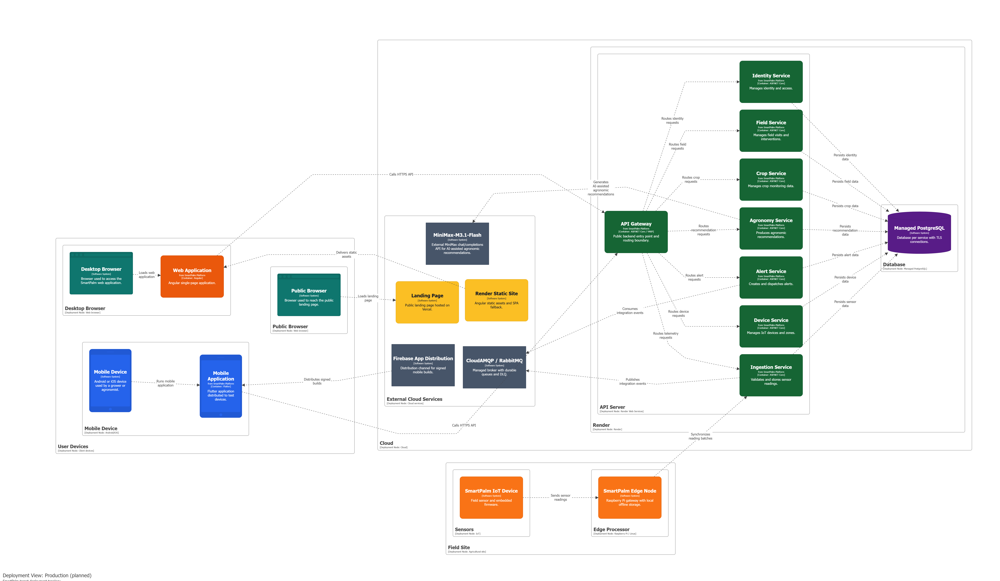

# Capítulo VII: Product Implementation, Validation & Deployment

## 7.1. Software Configuration Management

Este capítulo documenta la configuración técnica utilizada por el equipo TempWise para implementar y desplegar los componentes trabajados durante el primer sprint de SmartPalm: el desarrollo del backend en microservicios, la Web Application, las aplicaciones embedded para los dispositivos y el Edge API. El objetivo de esta sección es dejar evidencia clara de las herramientas, repositorios, convenciones y ambientes usados para construir esta primera versión del producto, alineando la planeación del sprint y el backlog a estos objetivos técnicos.

### 7.1.1. Software Development Environment Configuration

Durante el sprint, el equipo se enfocó en los frentes de implementación clave del sistema. Primero, el desarrollo del backend estructurado en microservicios, asegurando la lógica de negocio y la integración de los servicios core. Segundo, la Web Application, desarrollada para permitir la navegación inicial de los usuarios, dashboard, gestión de plantaciones, alertas, recomendaciones, reportes, dispositivos y suscripciones. Tercero, el desarrollo de las aplicaciones embedded orientadas a los dispositivos de campo y la configuración del Edge API para la gestión de la capa de borde. Cabe destacar que el proyecto no utiliza "mock-apis", por lo que toda la arquitectura descrita opera directamente sobre los microservicios y repositorios oficiales de la organización, de los cuales se puede extraer el historial de commits y sus enlaces correspondientes.

| Category | Tool / Platform | Usage in Sprint 1 | Reference |
|---|---|---|---|
| Project Management | Trello | Organización de tareas, historias de usuario y seguimiento del sprint. | https://trello.com/b/HSjBsXFx/grupo-2-fundamentos-de-arquitectura-de-software |
| Source Code Management | Git + GitHub | Control de versiones, ramas, commits y colaboración del equipo. | https://github.com/orgs/1ASI0728-Equipo2-Arquitectura-Software/repositories|
| Report Documentation | Markdown + GitHub | Documentación del avance del proyecto bajo enfoque Docs-as-Code. | https://github.com/1ASI0728-Equipo2-Arquitectura-Software/smartpalm-report |
| UX/UI Design | Figma | Diseño de wireframes, mock-ups y flujos de Landing Page y Web Application. |https://www.figma.com/design/bFDv7p60jPElSFuoSRZF1H/WebApp?node-id=0-1&p=f |
| Collaborative Modeling | Miro | Modelado colaborativo previo de procesos y dominio del producto. | https://miro.com/app/board/uXjVHdJ_3Wo=/?share_link_id=547546845690 |
| Web Application Development | Angular | Desarrollo de la Web Application de SmartPalm. | |
| Code Editor | Visual Studio Code | Edición de código fuente, archivos Markdown y configuración de proyecto. | https://code.visualstudio.com |
| Static Site Deployment | Vercel | Publicación del Landing Page. | |
| Web App Deployment | Render Static Site | Publicación de la Web Application Angular. |  |

### 7.1.2. Source Code Management

El equipo utiliza Git como sistema de control de versiones y GitHub como plataforma de alojamiento remoto. Para el desarrollo, los repositorios relevantes corresponden al informe del proyecto, Landing Page, Web Application, Web Service, Mobile Application, Edge Service, Embedded Application y Mock API.

 

**GitHub Repositories**

| Product | Repository | Purpose | Status |
|---|---|---|---|
| Project Report | `smartpalm-report` | Contiene el informe, anexos y evidencias documentales del proyecto. | https://github.com/1ASI0728-Equipo2-Arquitectura-Software/smartpalm-report|
| Landing Page | `website` | Contiene el sitio público de SmartPalm con propuesta de valor, segmentos, beneficios, pricing y equipo. | https://github.com/upc-202601-1asi0572-6779-teamwise/website |
| Web Application | `webapp-test` | Contiene la Web Application principal, incluyendo los bounded contexts y componentes compartidos implementados por el equipo. | https://github.com/1ASI0728-Equipo2-Arquitectura-Software/SmartPalm-WebApp |
| API Gateway | `apigateway` | Contiene el RESTful API desarrollado con ASP.NET Core, centraliza los bounded contexts de backend, persistencia y documentación de endpoints mediante Swagger. | https://github.com/1ASI0728-Equipo2-Arquitectura-Software/SmartPalm.ApiGateway |
| Device Service | `deviceservice` | Contiene el RESTful API desarrollado con ASP.NET Core, para el bounded context IoT Device Management, persistencia y documentación de endpoints mediante Swagger. | https://github.com/1ASI0728-Equipo2-Arquitectura-Software/SmartPalm.DeviceService |
| Ingestion Service | `ingestionservice` | Contiene el RESTful API desarrollado con ASP.NET Core, para el bounded context Sensor Data Processing, persistencia y documentación de endpoints mediante Swagger. | https://github.com/1ASI0728-Equipo2-Arquitectura-Software/SmartPalm.IngestionService |
| Agronomy Service | `agronomyservice` | Contiene el RESTful API desarrollado con ASP.NET Core, para el bounded context Agronomy, persistencia y documentación de endpoints mediante Swagger. | https://github.com/1ASI0728-Equipo2-Arquitectura-Software/SmartPalm.AgronomyService |
| Crop Service | `cropservice` | Contiene el RESTful API desarrollado con ASP.NET Core, para el bounded context Crop Management, persistencia y documentación de endpoints mediante Swagger. | https://github.com/1ASI0728-Equipo2-Arquitectura-Software/SmartPalm.CropService |
| Alert Service | `alertservice` | Contiene el RESTful API desarrollado con ASP.NET Core, para el bounded context Alert Management, persistencia y documentación de endpoints mediante Swagger. | https://github.com/1ASI0728-Equipo2-Arquitectura-Software/SmartPalm.AlertService |
| Field Service | `fieldservice` | Contiene el RESTful API desarrollado con ASP.NET Core, para el bounded context Field Management, persistencia y documentación de endpoints mediante Swagger. | https://github.com/1ASI0728-Equipo2-Arquitectura-Software/SmartPalm.FieldService |
| Identity, Subscription and Payments Service | `identityservice` | Contiene el RESTful API desarrollado con ASP.NET Core, para el bounded context Identity, Subscription and Payments, persistencia y documentación de endpoints mediante Swagger. | https://github.com/1ASI0728-Equipo2-Arquitectura-Software/SmartPalm.IdentityService |
| Mobile Application | `mobileapp` | Contiene la aplicación móvil desarrollada con Flutter para permitir la consulta y operación de funcionalidades de SmartPalm desde campo. | https://github.com/1ASI0728-Equipo2-Arquitectura-Software/SmartPalm-MobileApp |
| Edge Service | `edgeservice` | Contiene el Edge API desarrollado con Python para gestionar la comunicación y sincronización de datos entre el dispositivo IoT y la plataforma cloud. | https://github.com/1ASI0728-Equipo2-Arquitectura-Software/edge-api |
| Embedded Application | `embeddedapp` | Contiene el código de la aplicación embebida ejecutada en el dispositivo IoT para obtener y transmitir lecturas sensoriales. |https://github.com/1ASI0728-Equipo2-Arquitectura-Software/edge-node |

 

**GitFlow Workflow**

El flujo de trabajo se organiza con ramas principales y ramas por funcionalidad. Esta estructura permite separar el código estable, la integración de avances y el desarrollo de funcionalidades específicas.

| Branch Type | Convention | Purpose |
|---|---|---|
| Main Branch | `main` | Contiene versiones estables o entregables finales. |
| Development Branch | `develop` | Integra los avances antes de pasar a una versión estable. |
| Feature Branches | `feature/<description>` | Agrupan funcionalidades o secciones específicas del producto. |
| Deployment Branch | `deploy` | Agrupa ajustes de publicación y configuración de despliegue cuando corresponde. |

 

**Conventional Commits**

Los commits siguen una estructura basada en Conventional Commits para mantener trazabilidad.

| Type | Usage | Example |
|---|---|---|
| `feat` | Nueva funcionalidad. | `feat(dashboard): replace placeholder with real dashboard and 5 widgets` |
| `fix` | Corrección de errores. | `fix(auth): improve login and registration feedback` |
| `docs` | Cambios de documentación. | `docs: update chapter 6 evidence` |
| `refactor` | Mejora interna sin cambiar la funcionalidad esperada. | `refactor(alerts): redesign list with left-border severity` |
| `config` | Configuración de entorno o despliegue. | `config(cloudflare): add SPA fallback` |

### 7.1.3. Source Code Style Guide & Coding Conventions

El equipo define convenciones de código para mantener legibilidad, consistencia y trazabilidad entre los productos implementados durante los sprints.

| Element | Convention | Example |
|---|---|---|
| Angular Components | PascalCase | `DashboardComponent`, `PlantationDetailComponent` |
| Services | PascalCase with `Service` suffix | `PlantationService`, `AlertService` |
| Methods and Variables | camelCase | `getActiveAlerts()`, `currentPlantation` |
| Constants | UPPER_SNAKE_CASE | `MAX_VISIBLE_ALERTS` |
| Files and Folders | kebab-case | `plantation-detail.component.ts` |
| Routes | Lowercase route paths | `/dashboard`, `/plantaciones`, `/alertas` |
| Branches | kebab-case | `feature/dashboard-redesign` |
| Commits | English and imperative | `feat(subscription): add role-aware plans` |

 

**General Rules**

- El código fuente, nombres técnicos y commits se redactan en inglés.
- Los textos visibles al usuario pueden estar en español cuando formen parte de la experiencia de SmartPalm.
- Las funcionalidades se organizan por módulo: `auth`, `dashboard`, `plantations`, `devices`, `alerts`, `recommendations`, `reports`, `inspections`, `profile` y `subscription`.

 

**Project Boards and Design References**

| Resource | URL |
|---|---|
| Trello Board | https://trello.com/b/HSjBsXFx/grupo-2-fundamentos-de-arquitectura-de-software |
| Figma WebApp Design | https://www.figma.com/design/bFDv7p60jPElSFuoSRZF1H/WebApp?node-id=0-1&p=f |

### 7.1.4. Software Deployment Configuration

**Evidencia y estado del despliegue**

| Artefacto | Plataforma / tecnología | URL pública o repositorio | Estado |
|---|---|---|---|
| Landing Page | Vercel Static Hosting, CDN y HTTPS | https://smartpalm-landing.vercel.app/ | Desplegado |
| Web Application | Render Static Site, Angular | https://smartpalm-webapp.onrender.com/auth/login | Desplegado |
| Mobile Application | Flutter + Firebase App Distribution | https://github.com/1ASI0728-Equipo2-Arquitectura-Software/SmartPalm-MobileApp | Planned / Target architecture |
| API Gateway | Render Web Service, ASP.NET Core/YARP | https://github.com/1ASI0728-Equipo2-Arquitectura-Software/SmartPalm.ApiGateway | Planned / Target architecture |
| Microservicios de dominio | Render Web Services, ASP.NET Core/Docker | Repositorios `DeviceService`, `IngestionService`, `AlertService`, `AgronomyService`, `CropService`, `FieldService` e `IdentityService` | Planned / Target architecture |
| Message broker | CloudAMQP, RabbitMQ sobre AMQPS | Conexión administrada por el proveedor | Planned / Target architecture |
| Edge Node | Raspberry Pi, Edge API en Python y SQLite | Repositorio `edge-api` | Planned / Target architecture |
| Dispositivo IoT | Sensores de campo, firmware C++ y LoRaWAN/Wi-Fi | Repositorio `edge-node` | Planned / Target architecture |

 

**Deployment Configuration Summary**

| Componente | Configuración |
|---|---|
| Landing Page | Publicación estática en Vercel con HTTPS y CDN. |
| Web Application | Publicación de los artefactos Angular en Render Static Site, incluyendo fallback para rutas SPA. |
| API Gateway y microservicios | Servicios independientes en Render; el gateway es el único punto de entrada público y enruta hacia los bounded contexts. |
| CloudAMQP / RabbitMQ | Conexión AMQPS, colas durables, confirmaciones, reintentos y dead-letter queues para eventos de integración. |
| Edge API | Buffer local SQLite con operación offline acotada y sincronización idempotente de lotes hacia `IngestionService`. |
| Health checks | Cada servicio de Render expone verificaciones de disponibilidad y preparación; la promoción depende de su resultado. |
| Variables y secretos | `DATABASE_URL`, `RABBITMQ_URL`, firma JWT, CORS, credenciales de Firebase y claves de proveedores se administran en las plataformas y no se almacenan en Git. |
| Redes y TLS | HTTPS para clientes; TLS para PostgreSQL y CloudAMQP; comunicación interna mediante la red privada de Render cuando esté disponible. |
| Escalabilidad | Los servicios escalan de manera independiente; `IngestionService` es el principal candidato para réplicas adicionales por las ráfagas de telemetría. |

 

**C4 Deployment Diagram - Structurizr DSL**

El siguiente código DSL representa el despliegue completo proyectado para SmartPalm. Incluye los artefactos ya desplegados en Sprint 1, como Landing Page, Web Application, Web Services, y también la arquitectura completa prevista para el producto: Mobile Application, RESTful API, base de datos, Edge API, gateway LoRaWAN, dispositivo ESP32, sensores de campo e integración de servicios externos como proveedores de IA.

 
