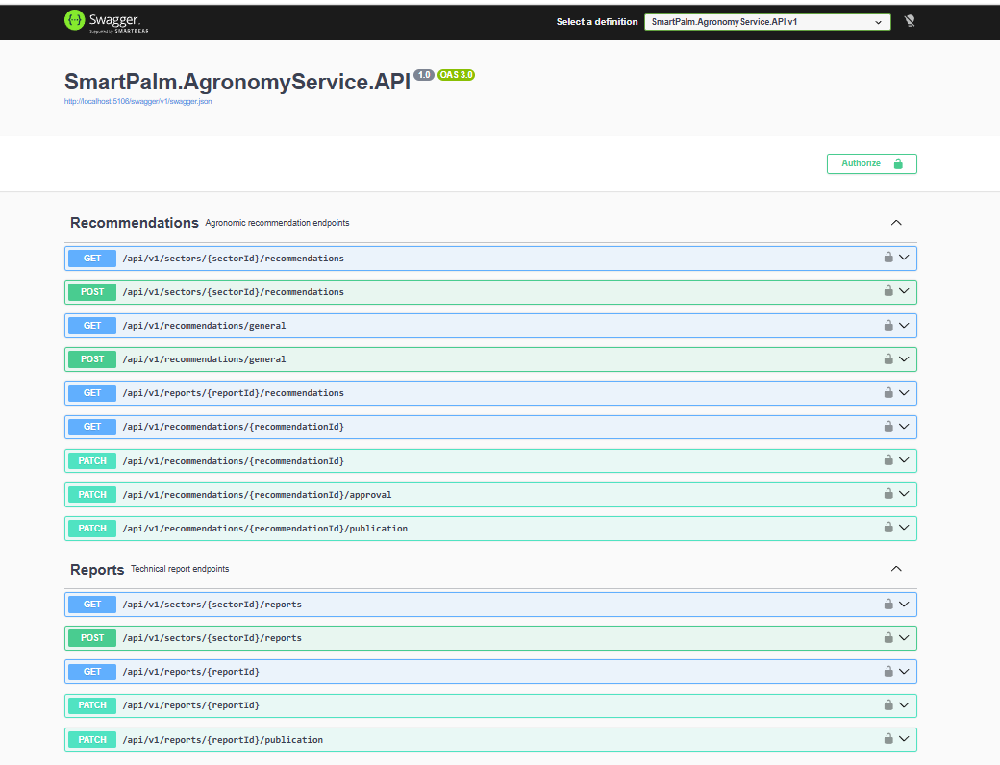
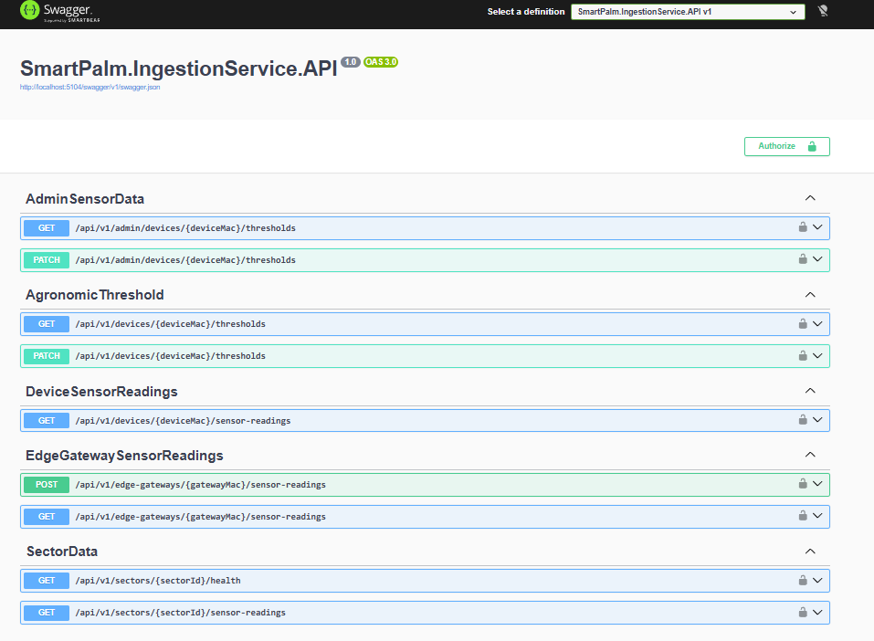

#### 7.2.1.1. Sprint Planning 1

| Field | Value |
|---|---|
| Sprint # | Sprint 1 |
| Sprint Planning Background | Primera entrega visible de SmartPalm, centrada en presentar el producto mediante el Landing Page, habilitar la navegación inicial de la Web Application y usar una Mock API para simular datos del dominio agrícola. |
| Date | 2026-11-11 |
| Prepared By | Victor Manuel Rojas Reategui |
| Attendees (to planning meeting) | Victor Rojas / Camila Conde / Mauricio Muñoz / Jeremy Paucar / Kenyi Ramirez |
| Sprint 0 Review Summary | No aplica. Sprint 1 corresponde a la primera entrega de implementación. |
| Sprint 0 Retrospective Summary | No aplica. No existió un sprint anterior cerrado. |
| Sprint Goal & User Stories | Entregar una primera experiencia funcional compuesta por Landing Page, Pruebas de Iot, IA y Web Application, cubriendo propuesta de valor, planes, registro inicial, plantaciones y monitoreo por zona. |
| Sprint 1 Goal | Our focus is on delivering the first public and navigable experience of SmartPalm. We believe it provides early product visibility for visitors and an initial operational view for agronomists and growers. This will be confirmed when the Landing Page is deployed, the Mock API provides representative data, and the Web Application allows navigation through the main crop monitoring views. |
| Sprint 1 Velocity | 25 |
| Sum of Story Points | 25 |

**Sprint Board:** https://trello.com/b/HSjBsXFx/grupo-2-fundamentos-de-arquitectura-de-software

**Figma WebApp Design:** https://www.figma.com/design/bFDv7p60jPElSFuoSRZF1H/WebApp?node-id=0-1&t=odRCfuqOyekerhH2-1

**User Stories included in Sprint 1**

| Order | User Story Id | Title | Description | Story Points |
|---:|---|---|---|---:|
| 1 | US001 | Presentar la propuesta de valor de Smart Palm | Como visitante interesado en mejorar la gestión de mi cultivo de palma aceitera, quiero conocer la propuesta de valor de Smart Palm, para entender cómo la plataforma puede ayudarme a monitorear y proteger mi plantación. | 2 |
| 2 | US002 | Consultar los planes de suscripción disponibles | Como visitante interesado en contratar Smart Palm, quiero conocer los planes de suscripción disponibles, para evaluar cuál se ajusta al tamaño y necesidades de mi operación. | 2 |
| 3 | US006 | Conocer información institucional sobre TempWise | Como visitante del Landing Page, quiero conocer información sobre la startup TempWise y el equipo detrás de Smart Palm, para evaluar la credibilidad y experiencia del proveedor de la solución. | 1 |
| 4 | US003 | Iniciar el proceso de contratación de un plan | Como visitante interesado en contratar Smart Palm, quiero iniciar el proceso de suscripción a un plan desde el Landing Page, para comenzar a utilizar la plataforma de manera oficial. | 3 |
| 5 | US004 | Completar el registro asociado al plan contratado | Como visitante que ha seleccionado un plan, quiero completar mi registro como usuario de la plataforma, para finalizar la contratación del plan y obtener acceso al producto. | 3 |
| 6 | US005 | Completar el proceso de pago de la suscripción | Como visitante que ha completado su registro, quiero completar el pago del plan seleccionado, para activar formalmente mi suscripción a Smart Palm. | 5 |
| 7 | US007 | Visualizar el panel general de plantaciones asignadas | Como ingeniero agrónomo, quiero visualizar un panel general de las plantaciones que superviso, para tener una vista consolidada del estado de todos los cultivos bajo mi responsabilidad. | 3 |
| 8 | US008 | Consultar el detalle técnico de una plantación | Como ingeniero agrónomo, quiero consultar el detalle técnico de una plantación en la aplicación web, para analizar sus zonas de monitoreo y las condiciones del cultivo. | 3 |
| 9 | US009 | Visualizar el estado del cultivo por zona | Como ingeniero agrónomo, quiero visualizar el estado de cada zona de monitoreo de una plantación, para identificar qué sectores presentan mejores o peores condiciones. | 3 |

#### 7.2.1.2. Aspect Leaders and Collaborators

| Team Member (Last Name, First Name) | GitHub Username | Landing Page | Mock API | Web Application | Deployment | Documentation |
|---|---|---|---|---|---|---|
| Rojas Reategui, Victor Manuel | `VRojas1603` | C | C | C | C | L |
| Vilcapoma Muñoz, Mauricio | `MauricioMVilcapoma` | L |  | C | C | C |
| Cabrera Ramirez, Kenyi | `Kenyi15upc` | C | C | C |  | C |
| Conde Isla, Camila | `camilac07` |  |  | C | C | C |
| Paucar Meneses, Jeremy Alión | `asmip_10` | C | L | L | L | C |

#### 7.2.1.3. Sprint Backlog 1

El Sprint Backlog 1 se organizó a partir de las historias priorizadas del Product Backlog. La selección cubre la experiencia pública del Landing Page, el flujo comercial inicial y las primeras vistas funcionales de la Web Application usando datos simulados desde la Mock API.

| Sprint # | User Story Id | User Story Title | User Story Description | Story Points | Work-Item / Task Id | Work-Item / Task Title | Work-Item / Task Description | Estimation (Hours) | Assigned To | Status |
|---|---|---|---|---:|---|---|---|---:|---|---|
| Sprint 1 | US001 | Presentar la propuesta de valor de Smart Palm | Como visitante interesado en mejorar la gestión de mi cultivo de palma aceitera, quiero conocer la propuesta de valor de Smart Palm, para entender cómo la plataforma puede ayudarme a monitorear y proteger mi plantación. | 2 | TK01 | Landing Page: Hero y propuesta de valor | Implementar la cabecera principal con mensaje de SmartPalm, beneficios principales y llamados a la acción. | 5 | Mauricio Muñoz / Victor Rojas | Done |
| Sprint 1 | US002 | Consultar los planes de suscripción disponibles | Como visitante interesado en contratar Smart Palm, quiero conocer los planes de suscripción disponibles, para evaluar cuál se ajusta al tamaño y necesidades de mi operación. | 2 | TK02 | Landing Page: Pricing | Implementar la sección de planes de suscripción con diferencias por cobertura y funcionalidades. | 5 | Mauricio M | Done |
| Sprint 1 | US006 | Conocer información institucional sobre TempWise | Como visitante del Landing Page, quiero conocer información sobre la startup TempWise y el equipo detrás de Smart Palm, para evaluar la credibilidad y experiencia del proveedor de la solución. | 1 | TK03 | Landing Page: About Team | Implementar sección institucional y presentación del equipo TempWise. | 4 | Mauricio M / Camila C | Done |
| Sprint 1 | US003 | Iniciar el proceso de contratación de un plan | Como visitante interesado en contratar Smart Palm, quiero iniciar el proceso de suscripción a un plan desde el Landing Page, para comenzar a utilizar la plataforma de manera oficial. | 3 | TK04 | Landing Page: CTA de contratación | Conectar los llamados a la acción del Landing Page con la experiencia de registro o acceso. | 6 | Kenyi R / Jeremy Paucar | Done |
| Sprint 1 | US004 | Completar el registro asociado al plan contratado | Como visitante que ha seleccionado un plan, quiero completar mi registro como usuario de la plataforma, para finalizar la contratación del plan y obtener acceso al producto. | 3 | TK05 | Web Application: Registro | Implementar registro de usuario y flujo inicial de cuenta. | 8 | Jeremy Paucar | Done |
| Sprint 1 | US005 | Completar el proceso de pago de la suscripción | Como visitante que ha completado su registro, quiero completar el pago del plan seleccionado, para activar formalmente mi suscripción a Smart Palm. | 5 | TK06 | Web Application: Suscripciones | Implementar vistas de planes, suscripción actual y cambio de plan usando datos simulados. | 10 | Jeremy Paucar | Done |
| Sprint 1 | US007 | Visualizar el panel general de plantaciones asignadas | Como ingeniero agrónomo, quiero visualizar un panel general de las plantaciones que superviso, para tener una vista consolidada del estado de todos los cultivos bajo mi responsabilidad. | 3 | TK07 | Web Application: Dashboard | Implementar dashboard con resumen de plantaciones, alertas, recomendaciones y dispositivos. | 8 | Jeremy Paucar / Victor Rojas| Done |
| Sprint 1 | US008 | Consultar el detalle técnico de una plantación | Como ingeniero agrónomo, quiero consultar el detalle técnico de una plantación en la aplicación web, para analizar sus zonas de monitoreo y las condiciones del cultivo. | 3 | TK08 | Web Application: Detalle de plantación | Implementar vista de detalle con zonas, estado del cultivo y alertas asociadas. | 8 | Jeremy Paucar / Victor Rojas | Done |
| Sprint 1 | US009 | Visualizar el estado del cultivo por zona | Como ingeniero agrónomo, quiero visualizar el estado de cada zona de monitoreo de una plantación, para identificar qué sectores presentan mejores o peores condiciones. | 3 | TK09 | Web Application: Estado por zona | Mostrar datos simulados de zonas y lecturas relevantes desde la Mock API. | 8 | Jeremy Paucar / Victor Rojas | Done |

#### 7.2.1.4. Development Evidence for Sprint Review

Durante el Sprint 1 se implementaron los artefactos necesarios para validar la experiencia inicial de SmartPalm: Landing Page y Web Application. 

**Landing Page Repository:** https://github.com/1ASI0728-Equipo2-Arquitectura-Software/SmartPalm-LandingPage

| Repository | Branch | Commit Id | Commit Message | Commit Message Body | Committed on (Date) |
|---|---|---|---|---|---|
| landing-page | `feature/initial-landing-setup` | `cf26396` | `feat: add navigation header and styles` | Agrega navegación principal y estilos iniciales del Landing Page. | 2026-05-14 |
| landing-page | `feature/initial-landing-setup` | `80aa492` | `feat(landing): add core UI scripts, animations, and i18n logic` | Agrega scripts base, animaciones e internacionalización. | 2026-05-14 |
| landing-page | `feature/hero-section` | `847f996` | `feature: add hero section` | Implementa la sección Hero del Landing Page. | 2026-05-14 |
| landing-page | `feature/hero-section` | `cf0aa60` | `feature: apply style for the hero section` | Agrega estilos visuales para el Hero Section. | 2026-05-14 |
| landing-page | `feature/about-the-product` | `4d38d5c` | `feat: added about the product section` | Implementa la sección About the Product. | 2026-05-14 |
| landing-page | `feature/about-the-product` | `04c7de2` | `feat: added about the product styles` | Agrega estilos para About the Product. | 2026-05-14 |
| landing-page | `feature/benefits-section` | `bf80ac5` | `feature: added benefits / features section` | Implementa sección de beneficios y características. | 2026-05-15 |
| landing-page | `feature/pricing-section` | `a689f0b` | `feat(pricing): add pricing section markup with i18n keys` | Implementa estructura de pricing con claves i18n. | 2026-05-15 |
| landing-page | `feature/pricing-section` | `7e6d1cf` | `feat(pricing): add pricing styles and responsive layout` | Agrega estilos responsive para pricing. | 2026-05-15 |
| landing-page | `feature/segments` | `025cafc` | `feat: add segments section` | Implementa sección de segmentos objetivo. | 2026-06-12 |
| landing-page | `feature/about-the-team` | `90bad9e` | `feature: update about the team section` | Actualiza la sección del equipo. | 2026-06-12 |
| landing-page | `feature/footer` | `9e99d3a` | `feat:add footer section` | Implementa footer del Landing Page. | 2026-06-12 |

**Web Application Repository:** https://github.com/1ASI0728-Equipo2-Arquitectura-Software/SmartPalm-WebApp

| Repository | Branch | Commit Id | Commit Message | Commit Message Body | Committed on (Date) |
|---|---|---|---|---|---|
| web-application | `develop` | `56c8eb1` | `feat(sensors): add sensor reading model and service for BC-02` | Agrega modelo y servicio para lecturas sensoriales consumidas por la Web Application. | 2026-05-13 |
| web-application | `develop` | `1d6d241` | `feat(dashboard): replace placeholder with real dashboard and 5 widgets` | Implementa dashboard funcional con widgets principales. | 2026-05-13 |
| web-application | `develop` | `2b13890` | `feat(reports): add read-only report list and detail pages` | Agrega vistas de listado y detalle de reportes. | 2026-05-13 |
| web-application | `develop` | `6ed2631` | `feat(agronomist): add role-aware sidebar and agronomist guard` | Agrega navegación por rol para la experiencia del agrónomo. | 2026-05-13 |
| web-application | `develop` | `bd61006` | `feat(agronomist): add recommendation create, approve, publish flow with role tabs` | Implementa flujo de recomendaciones agronómicas. | 2026-05-13 |
| web-application | `develop` | `22891a9` | `feat(agronomist): add report generation, publish and sections display with role tabs` | Agrega generación y publicación de reportes. | 2026-05-13 |
| web-application | `develop` | `f3f7a6e` | `feat(agronomist): add field inspections feature with list and detail` | Agrega módulo de inspecciones de campo. | 2026-05-13 |
| web-application | `develop` | `05052a5` | `feat(subscription): add role-aware plans and subscription views with back navigation` | Agrega vistas de planes y suscripción por rol. | 2026-05-13 |
| web-application | `develop` | `9865b7b` | `refactor(alert-detail): full-width severity layout with visual range bar, spanish labels, and device context` | Mejora la vista de detalle de alerta. | 2026-05-14 |
| web-application | `deploy` | `1f1ed85` | `config(deploy): switch apiUrl to deployed Render mock API` | Configura la Web Application para consumir la Mock API desplegada. | 2026-05-14 |
| web-application | `deploy` | `e820d03` | `feat(sidebar): add active route highlighting with background, text color, and left border` | Mejora la navegación lateral. | 2026-05-14 |

#### 7.2.1.5. Execution Evidence for Sprint Review

El Sprint 1 dejó tres artefactos ejecutables: Landing Page, Web Application y Mock API. Estos permiten mostrar la propuesta de valor, navegar las vistas principales del producto y consumir datos simulados para validar la experiencia.

| Evidence | Implemented Result |
|---|---|
| Landing Page | Sitio público con Hero Section, beneficios, segmentos, planes de suscripción, información del equipo y footer. |
| Web Application | Aplicación Angular con login, registro, dashboard, plantaciones, dispositivos, alertas, recomendaciones, reportes, inspecciones, perfil y suscripciones. |

#### 7.2.1.6. Services Documentation Evidence for Sprint Review

En este sprint, la documentación de servicios corresponde únicamente a la Mock API. La Mock API permite simular los datos necesarios para que la Web Application muestre información de usuarios, suscripciones, plantaciones, zonas, dispositivos, lecturas, alertas, recomendaciones, reportes e inspecciones.

| Module | Mock Resource | Main Actions | Sprint Relevance |
|---|---|---|---|
| Access | `/api/v1/auth/register`, `/api/v1/auth/login`, `/api/v1/users/me` | Simular registro, login y consulta de perfil. | Permite navegar la Web Application con usuarios representativos. |
| Subscriptions | `/api/v1/subscriptions/plans`, `/api/v1/subscriptions/me`, `/api/v1/subscriptions/me/upgrade` | Consultar planes, suscripción actual y cambio de plan. | Soporta las historias de contratación y suscripción inicial. |
| Plantations | `/api/v1/plantations`, `/api/v1/plantations/:id`, `/api/v1/plantations/:plantationId/zones` | Consultar plantaciones, detalle técnico y zonas de monitoreo. | Soporta dashboard, listado y detalle de plantaciones. |
| Devices | `/api/v1/devices`, `/api/v1/devices/:id`, `/api/v1/devices/:id/zone` | Consultar dispositivos asociados a plantaciones y zonas. | Permite evidenciar el componente IoT dentro de la experiencia web. |
| Sensor Readings | `/api/v1/readings` | Consultar lecturas simuladas por variable, zona, dispositivo o plantación. | Alimenta la visualización del estado del cultivo. |
| Alerts | `/api/v1/alerts`, `/api/v1/alerts/:id`, `/api/v1/alerts/:id/acknowledge` | Consultar alertas activas, detalle de alerta y reconocimiento. | Permite priorizar condiciones críticas dentro de la Web Application. |
| Recommendations | `/api/v1/recommendations`, `/api/v1/recommendations/:id/approve`, `/api/v1/recommendations/:id/publish` | Consultar, aprobar y publicar recomendaciones agronómicas. | Soporta la experiencia del agrónomo y del productor. |
| Reports | `/api/v1/reports`, `/api/v1/reports/generate-draft`, `/api/v1/reports/:id/publish` | Consultar, generar y publicar reportes. | Permite mostrar documentación del estado del cultivo. |
| Field Records | `/api/v1/inspections`, `/api/v1/interventions` | Consultar inspecciones e intervenciones simuladas. | Complementa la trazabilidad del seguimiento agronómico. |

#### Agronomy Service 

#### Ingestion Service 

#### 7.2.1.7. Software Deployment Evidence for Sprint Review

En el Sprint 1 se desplegaron los tres artefactos del alcance: Landing Page, Web Application y Mock API.

| Artifact | Deployment Status | URL / Environment |
|---|---|---|
| Landing Page | Deployed | https://smart-palm.netlify.app/ |

#### 7.2.1.8. Team Collaboration Insights during Sprint

Durante el Sprint 1, el equipo distribuyó el trabajo en tres frentes: Landing Page y Web Application. El Landing Page permitió mostrar la propuesta de valor y el modelo comercial de SmartPalm. La Web Application permitió navegar las primeras vistas funcionales del sistema usando datos simulados.

| Team Member | Sprint 1 Contribution |
|---|---|
| Victor Manuel Rojas Reategui | Coordinación documental, integración del reporte y apoyo en producto. |
| Camila Conde Isla | Liderazgo del Landing Page y apoyo en diseño de la experiencia pública. |
| Mauricio Muñoz | Colaboración en estructura funcional y documentación técnica del producto. |
| Kenyi Ramirez | Colaboración en arquitectura y soporte de organización técnica. |
| Jeremy Alión Paucar Meneses | Liderazgo de Web Application, Mock API y despliegue de la experiencia funcional. |

