#### 7.2.1.1. Sprint Planning 1

| Field | Value |
|---|---|
| Sprint # | Sprint 1 |
| Sprint Planning Background | Primera entrega visible de SmartPalm, centrada en presentar el producto mediante el Landing Page, habilitar la navegación inicial de la Web Application, y conectar los servicios de microservicios mediante el API Gateway. |
| Date | 2026-11-11 |
| Prepared By | Victor Manuel Rojas Reategui |
| Attendees (to planning meeting) | Victor Rojas / Camila Conde / Mauricio Muñoz / Jeremy Paucar / Kenyi Ramirez |
| Sprint 0 Review Summary | No aplica. Sprint 1 corresponde a la primera entrega de implementación. |
| Sprint 0 Retrospective Summary | No aplica. No existió un sprint anterior cerrado. |
| Sprint Goal & User Stories | Entregar una primera experiencia funcional compuesta por Landing Page, Pruebas de Iot, IA y Web Application, cubriendo propuesta de valor, planes, registro inicial, plantaciones y monitoreo por zona. |
| Sprint 1 Goal | Our focus is on delivering the first public and navigable experience of SmartPalm backed by a fully integrated microservices architecture through the API Gateway. We believe it provides early product visibility for visitors and an initial operational view for agronomists and growers. This will be confirmed when the Landing Page is deployed, the API Gateway orchestrates the microservices, and the Web Application allows navigation through the main management and monitoring views. |
| Sprint 1 Velocity | 48 |
| Sum of Story Points | 48 |

**Sprint Board:** https://trello.com/b/HSjBsXFx/grupo-2-fundamentos-de-arquitectura-de-software

**Figma WebApp Design:** https://www.figma.com/design/bFDv7p60jPElSFuoSRZF1H/WebApp?node-id=0-1&t=odRCfuqOyekerhH2-1

**User Stories included in Sprint 1**

| Order | User Story Id | Title | Description | Story Points |
|---:|---|---|---|---:|
| 1 | US001 | Presentar la propuesta de valor de Smart Palm | Como visitante interesado en mejorar la gestión de mi cultivo de palma aceitera, quiero conocer la propuesta de valor de Smart Palm, para entender cómo la plataforma puede ayudarme a monitorear y proteger mi plantación. | 2 |
| 2 | US002 | Consultar los planes de suscripción disponibles | Como visitante interesado en contratar Smart Palm, quiero conocer los planes de suscripción disponibles, para evaluar cuál se ajusta al tamaño y necesidades de mi operación. | 2 |
| 3 | US006 | Conocer información institucional sobre TempWise | Como visitante del Landing Page, quiero conocer información sobre la startup TempWise y el equipo detrás de Smart Palm, para evaluar la credibilidad y experiencia del proveedor de la solución. | 1 |
| 4 | US003 | Iniciar el proceso de contratación de un plan | Como visitante interesado en contratar Smart Palm, quiero iniciar el proceso de suscripción a un plan desde el Landing Page, para comenzar a utilizar la plataforma de manera oficial. | 3 |
| 5 | US004 | Completar el registro asociado al plan contratado | Como visitante que ha seleccionado un plan, quiero completar mi registro como usuario de la plataforma, para finalizar la contratación del plan y obtener acceso al producto. | 3 |
| 6 | US005 | Completar el proceso de pago de la suscripción | Como visitante que ha completado su registro, quiero completar el pago del plan seleccionado, para activar formalmente mi suscripción a Smart Palm. | 5 |
| 7 | US007 | Visualizar el panel general de plantaciones asignadas | Como ingeniero agrónomo, quiero visualizar un panel general de las plantaciones que superviso, para tener una vista consolidada del estado de todos los cultivos bajo mi responsabilidad. | 3 |
| 8 | US008 | Consultar el detalle técnico de una plantación | Como ingeniero agrónomo, quiero consultar el detalle técnico de una plantación en la aplicación web, para analizar sus zonas de monitoreo y las condiciones del cultivo. | 3 |
| 9 | US009 | Visualizar el estado del cultivo por zona | Como ingeniero agrónomo, quiero visualizar el estado de cada zona de monitoreo de una plantación, para identificar qué sectores presentan mejores o peores condiciones. | 3 |

#### 7.2.1.2. Aspect Leaders and Collaborators

| Team Member (Last Name, First Name) | GitHub Username | Landing Page |API Gateway & Microservices | Web Application | Deployment | Documentation |
|---|---|---|---|---|---|---|
| Rojas Reategui, Victor Manuel | `VRojas1603` | C | L | C | C | L |
| Vilcapoma Muñoz, Mauricio | `MauricioMVilcapoma` | L |  | C | C | C |
| Cabrera Ramirez, Kenyi | `Kenyi15upc` | C | C | C |  | C |
| Conde Isla, Camila | `camilac07` |  |  | C | C | C |
| Paucar Meneses, Jeremy Alión | `asmip_10` | C | L | L | L | C |

#### 7.2.1.3. Sprint Backlog 1

El Sprint Backlog 1 se organizó a partir de las historias priorizadas del Product Backlog. La selección cubre la experiencia pública del Landing Page, el flujo comercial inicial y las primeras vistas funcionales de la Web Application usando datos simulados desde la Mock API.

El Sprint Backlog 1 se organizó a partir de las historias priorizadas del Product Backlog, reflejando el desarrollo de los microservicios, el API Gateway, el Landing Page y la Web Application implementados en los repositorios del equipo.

| Sprint # | User Story Id | User Story Title | User Story Description | Work-Item / Task Id | Work-Item / Task Title | Work-Item / Task Description | Estimation (Hours) | Assigned To | Status |
|---|---|---|---|---:|---|---|---:|---|---|
| Sprint 1 | US001 | Presentar la propuesta de valor de Smart Palm | Como visitante interesado en mejorar la gestión de mi cultivo de palma aceitera, quiero conocer la propuesta de valor de Smart Palm, para entender cómo la plataforma puede ayudarme a monitorear y proteger mi plantación. | TK01 | Landing Page: Hero y propuesta de valor | Implementar la cabecera principal con mensaje de SmartPalm, beneficios principales y llamados a la acción. | 5 | Mauricio Muñoz / Victor Rojas | Done |
| Sprint 1 | US002 | Consultar los planes de suscripción disponibles | Como visitante interesado en contratar Smart Palm, quiero conocer los planes de suscripción disponibles, para evaluar cuál se ajusta al tamaño y necesidades de mi operación. | TK02 | Landing Page: Pricing | Implementar la sección de planes de suscripción con diferencias por cobertura y funcionalidades. | 5 | Mauricio Muñoz | Done |
| Sprint 1 | US003 | Direccionar al visitante hacia la aplicación correspondiente según su rol | Como visitante interesado en usar Smart Palm, quiero acceder a la aplicación correspondiente a mi rol desde el Landing Page, para iniciar mi experiencia en la plataforma. | TK03 | Landing Page: Redirección por roles | Configurar los accesos desde el landing hacia los distintos módulos de la aplicación web según el rol. | 4 | Mauricio Muñoz / Camila Conde | Done |
| Sprint 1 | US040 | Iniciar el proceso de contratación de un plan | Como visitante interesado en contratar Smart Palm, quiero iniciar el proceso de suscripción a un plan desde el Landing Page, para comenzar a utilizar la plataforma como dueño del cultivo. | TK04 | Landing Page: CTA de contratación | Conectar los llamados a la acción del Landing Page con la experiencia de registro o acceso a través del API Gateway. | 6 | Kenyi Ramirez / Jeremy Paucar | Done |
| Sprint 1 | US041 | Completar el registro asociado al plan contratado | Como visitante que ha seleccionado un plan, quiero completar mi registro como usuario de la plataforma, para finalizar la contratación del plan y avanzar al proceso de pago. | TK05 | Web Application & Identity Service: Registro | Implementar el flujo de registro de usuario en el frontend y su integración con Identity Service vía API Gateway. | 7 | Jeremy Paucar | Done |
| Sprint 1 | US042 | Completar el proceso de pago de la suscripción | Como visitante que ha completado su registro, quiero completar el pago del plan seleccionado, para activar formalmente mi suscripción a Smart Palm y acceder a la plataforma. | TK06 | Web Application & Identity Service: Suscripciones | Implementar vistas de planes, suscripción actual y pasarela de pago simulada conectada al backend. | 4 | Jeremy Paucar | Done |
| Sprint 1 | US007 | Visualizar el panel general de plantaciones asignadas | Como ingeniero agrónomo, quiero visualizar un panel general de las plantaciones que superviso, para tener una vista consolidada del estado de todos los cultivos bajo mi responsabilidad. | TK07 | Web Application & Crop Service: Dashboard | Implementar dashboard con resumen de plantaciones, alertas y dispositivos a través de Crop Service y API Gateway. | 8 | Jeremy Paucar / Victor Rojas | Done |
| Sprint 1 | US008 | Consultar el detalle técnico de una plantación | Como ingeniero agrónomo, quiero consultar el detalle técnico de una plantación en la aplicación web, para analizar sus zonas de monitoreo y las condiciones del cultivo. | TK08 | Web Application & Crop Service: Detalle de plantación | Implementar vista de detalle con sectores/zonas, estado del cultivo y servicios asociados. | 8 | Jeremy Paucar / Victor Rojas | Done |
| Sprint 1 | US009 | Visualizar el estado del cultivo por zona | Como ingeniero agrónomo, quiero visualizar el estado de cada zona de monitoreo de una plantación, para identificar qué sectores presentan mejores o peores condiciones. | TK09 | Web Application & Ingestion Service: Estado por zona | Mostrar datos de zonas y lecturas de sensores consumidos desde Ingestion Service mediante el API Gateway. | 8 | Jeremy Paucar / Victor Rojas | Done |
| Sprint 1 | US044 | Iniciar sesión en la plataforma | Como usuario registrado, quiero iniciar sesión en Smart Palm, para acceder de forma segura a mis plantaciones, zonas y funcionalidades. | TK10 | Web Application & Identity Service: Autenticación | Implementar el formulario de inicio de sesión y validación de tokens JWT mediante API Gateway e Identity Service. | 6 | Kenyi Ramirez / Camila Conde | Done |
| Sprint 1 | TS001 | Exponer un API RESTful para la gestión de plantaciones y zonas | Como desarrollador, quiero exponer un API RESTful que permita gestionar plantaciones y zonas de monitoreo, para que los frontends web y móvil puedan crear, consultar, actualizar y eliminar esta información. | TK11 | Crop Service: API RESTful de Plantaciones | Desarrollar los endpoints de administración y consulta de plantaciones y sectores en `SmartPalm.CropService`. | 7 | Kenyi Ramirez | Done |
| Sprint 1 | TS002 | Exponer un API RESTful para la gestión de alertas y umbrales | Como desarrollador, quiero exponer un API RESTful para la gestión de alertas y umbrales técnicos, para que el frontend web y la aplicación móvil puedan consultar alertas activas, su historial, y permitir al agrónomo personalizar los umbrales por zona. | TK12 | Alert Service: API RESTful de Alertas | Desarrollar los endpoints de control de alertas, notificaciones y configuración de umbrales en `SmartPalm.AlertService`. | 6 | Camila Conde | Done |
| Sprint 1 | TS003 | Exponer un API RESTful para observaciones, recomendaciones y reportes | Como desarrollador, quiero exponer un API RESTful para la gestión de observaciones técnicas, recomendaciones agronómicas y reportes, para soportar el registro y consulta de estos artefactos desde el frontend web y la aplicación móvil. | TK13 | Agronomy Service: API RESTful de Recomendaciones y Reportes | Desarrollar los endpoints de recomendaciones, aprobación, publicación y reportes en `SmartPalm.AgronomyService`. | 8 | Victor Rojas | Done |
| Sprint 1 | TS004 | Implementar autenticación y control de acceso seguro | Como desarrollador, quiero implementar un mecanismo de autenticación y control de acceso basado en roles, para proteger la información de usuarios, plantaciones, dispositivos y registros de monitoreo. | TK14 | API Gateway & Identity Service: Seguridad y Enrutamiento | Configurar el enrutamiento centralizado y el filtrado de seguridad en `SmartPalm.ApiGateway` e `SmartPalm.IdentityService`. | 8 | Kenyi Ramirez / Victor Rojas | Done |

#### 7.2.1.4. Development Evidence for Sprint Review

Durante el Sprint 1 se implementaron los artefactos necesarios para validar la arquitectura de microservicios, el API Gateway, el Landing Page y la Web Application de SmartPalm.

 

**Landing Page Repository:** https://github.com/1ASI0728-Equipo2-Arquitectura-Software/SmartPalm-LandingPage

| Repository | Branch | Commit Id | Commit Message | Commit Message Body | Committed on (Date) |
|---|---|---|---|---|---|
| landing-page | `feature/initial-landing-setup` | `cf26396` | `feat: add navigation header and styles` | Agrega navegación principal y estilos iniciales del Landing Page. | 2026-05-14 |
| landing-page | `feature/initial-landing-setup` | `80aa492` | `feat(landing): add core UI scripts, animations, and i18n logic` | Agrega scripts base, animaciones e internacionalización. | 2026-05-14 |
| landing-page | `feature/hero-section` | `847f996` | `feature: add hero section` | Implementa la sección Hero del Landing Page. | 2026-05-14 |
| landing-page | `feature/hero-section` | `cf0aa60` | `feature: apply style for the hero section` | Agrega estilos visuales para el Hero Section. | 2026-05-14 |
| landing-page | `feature/about-the-product` | `4d38d5c` | `feat: added about the product section` | Implementa la sección About the Product. | 2026-05-14 |
| landing-page | `feature/about-the-product` | `04c7de2` | `feat: added about the product styles` | Agrega estilos para About the Product. | 2026-05-14 |
| landing-page | `feature/benefits-section` | `bf80ac5` | `feature: added benefits / features section` | Implementa sección de beneficios y características. | 2026-05-15 |
| landing-page | `feature/pricing-section` | `a689f0b` | `feat(pricing): add pricing section markup with i18n keys` | Implementa estructura de pricing con claves i18n. | 2026-05-15 |
| landing-page | `feature/pricing-section` | `7e6d1cf` | `feat(pricing): add pricing styles and responsive layout` | Agrega estilos responsive para pricing. | 2026-05-15 |
| landing-page | `feature/segments` | `025cafc` | `feat: add segments section` | Implementa sección de segmentos objetivo. | 2026-06-12 |
| landing-page | `feature/about-the-team` | `90bad9e` | `feature: update about the team section` | Actualiza la sección del equipo. | 2026-06-12 |
| landing-page | `feature/footer` | `9e99d3a` | `feat:add footer section` | Implementa footer del Landing Page. | 2026-06-12 |

  

**Web Application Repository:** https://github.com/1ASI0728-Equipo2-Arquitectura-Software/SmartPalm-WebApp

| Repository | Branch | Commit Id | Commit Message | Commit Message Body | Committed on (Date) |
|---|---|---|---|---|---|
| web-application | `develop` | `56c8eb1` | `feat(sensors): add sensor reading model and service for BC-02` | Agrega modelo y servicio para lecturas sensoriales consumidas por la Web Application. | 2026-05-13 |
| web-application | `develop` | `1d6d241` | `feat(dashboard): replace placeholder with real dashboard and 5 widgets` | Implementa dashboard funcional con widgets principales. | 2026-05-13 |
| web-application | `develop` | `2b13890` | `feat(reports): add read-only report list and detail pages` | Agrega vistas de listado y detalle de reportes. | 2026-05-13 |
| web-application | `develop` | `6ed2631` | `feat(agronomist): add role-aware sidebar and agronomist guard` | Agrega navegación por rol para la experiencia del agrónomo. | 2026-05-13 |
| web-application | `develop` | `bd61006` | `feat(agronomist): add recommendation create, approve, publish flow with role tabs` | Implementa flujo de recomendaciones agronómicas. | 2026-05-13 |
| web-application | `develop` | `22891a9` | `feat(agronomist): add report generation, publish and sections display with role tabs` | Agrega generación y publicación de reportes. | 2026-05-13 |
| web-application | `develop` | `f3f7a6e` | `feat(agronomist): add field inspections feature with list and detail` | Agrega módulo de inspecciones de campo. | 2026-05-13 |
| web-application | `develop` | `05052a5` | `feat(subscription): add role-aware plans and subscription views with back navigation` | Agrega vistas de planes y suscripción por rol. | 2026-05-13 |
| web-application | `develop` | `9865b7b` | `refactor(alert-detail): full-width severity layout with visual range bar, spanish labels, and device context` | Mejora la vista de detalle de alerta. | 2026-05-14 |
| web-application | `deploy` | `1f1ed85` | `config(deploy): switch apiUrl to deployed Render mock API` | Configura la Web Application para consumir los servicios centralizados. | 2026-05-14 |
| web-application | `deploy` | `e820d03` | `feat(sidebar): add active route highlighting with background, text color, and left border` | Mejora la navegación lateral. | 2026-05-14 |

 

**Agronomy Service Repository:** https://github.com/1ASI0728-Equipo2-Arquitectura-Software/SmartPalm.AgronomyService
| Repository | Branch | Commit Id | Commit Message | Commit Message Body | Committed on (Date) |
|---|---|---|---|---|---|
| agronomy-service | `main` | `f91e387`[cite: 10] | `feat(agronomy): consume user deletion events` | Implementa el consumidor de eventos para la eliminación de usuarios. | 2026-11-07 |
| agronomy-service | `main` | `6b7f32a`[cite: 10] | `feat(agronomy): purge agronomic records on deletion` | Permite purgar registros agronómicos al eliminar cuentas. | 2026-11-07 |
| agronomy-service | `main` | `87e8864`[cite: 10] | `Initial Commit` | Commit inicial del microservicio de agronomía. | 2026-11-05 |

 

**Identity Service Repository:** https://github.com/1ASI0728-Equipo2-Arquitectura-Software/SmartPalm.IdentityService

| Repository | Branch | Commit Id | Commit Message | Commit Message Body | Committed on (Date) |
|---|---|---|---|---|---|
| identity-service | `main` | `99f09d7`[cite: 11] | `feat(identity): expose user deletion API and completion consumer` | Expone API de eliminación de usuarios y consumidor de completitud. | 2026-11-07 |
| identity-service | `main` | `b53a99f`[cite: 11] | `feat(identity): orchestrate asynchronous user deletion` | Orquesta la eliminación asíncrona de usuarios. | 2026-11-07 |
| identity-service | `main` | `9d5dbfc`[cite: 11] | `chore(identity): add user deletion database migration` | Agrega migración de base de datos para eliminación de usuarios. | 2026-11-07|
| identity-service | `main` | `1968c93`[cite: 11] | `feat(identity): persist user deletion operations` | Persiste operaciones de eliminación de usuarios. | 2026-11-07 |
| identity-service | `main` | `4bf0d15`[cite: 11] | `feat(identity): add user data deletion repository operations` | Agrega operaciones de repositorio para borrado de datos. | 2026-11-07 |
| identity-service | `main` | `5a1a8b5`[cite: 11] | `feat(identity): add user deletion domain model` | Agrega modelo de dominio para eliminación de usuarios. | 2026-11-07 |
| identity-service | `main` | `fd31892`[cite: 11] | `Merge remote-tracking branch into develop` | Fusión de ramas para consultas de suscripción. | 2026-11-06 |
| identity-service | `main` | `fb0b6cd`[cite: 11] | `feat(identity): expose admin subscription status by user` | Expone estado de suscripción administrativa por usuario. | 2026-11-06 |
| identity-service | `main` | `7785d41`[cite: 11] | `Inital Commit` | Commit inicial del microservicio de identidad. | 2026-11-05 |

 

**Crop Service Repository:** https://github.com/1ASI0728-Equipo2-Arquitectura-Software/SmartPalm.CropService

| Repository | Branch | Commit Id | Commit Message | Commit Message Body | Committed on (Date) |
|---|---|---|---|---|---|
| crop-service | `main` | `6c862a9`[cite: 12] | `feat(crop): consume user deletion events` | Implementa consumo de eventos de eliminación de usuarios. | 2026-11-07 |
| crop-service | `main` | `920b363`[cite: 12] | `feat(crop): purge user-owned plantations on deletion` | Purga plantaciones propiedad del usuario al eliminarse la cuenta. | 2026-11-07|
| crop-service | `main` | `9c6f105`[cite: 12] | `feat(crop): add inbox persistence for deletion events` | Agrega persistencia de bandeja de entrada para eventos de borrado. | 2026-11-07 |
| crop-service | `main` | `5e525cb`[cite: 12] | `Merge branch 'feat/sector-identity' into develop` | Fusión de rama para identidad de sectores. | 2026-11-06 |
| crop-service | `main` | `aca6bc1`[cite: 12] | `feat(crop-service): return sector identity after assignment` | Retorna identidad del sector tras su asignación. | 2026-11-06 |
| crop-service | `main` | `89b822d`[cite: 12] | `Initial Commit` | Commit inicial del microservicio de cultivos. | 2026-11-05|

 

**Ingestion Service Repository:** https://github.com/1ASI0728-Equipo2-Arquitectura-Software/SmartPalm.IngestionService

| Repository | Branch | Commit Id | Commit Message | Commit Message Body | Committed on (Date) |
|---|---|---|---|---|---|
| ingestion-service | `main` | `4cb9d6c`[cite: 13] | `feat(ingestion): consume user deletion events` | Consume eventos de eliminación de usuarios. | 2026-11-07 |
| ingestion-service | `main` | `62100ff`[cite: 13] | `feat(ingestion): purge telemetry and projections on deletion` | Purga telemetría y proyecciones al eliminar cuentas. | 2026-11-07 |
| ingestion-service | `main` | `acf8f3e`[cite: 13] | `Initial Commit` | Commit inicial del microservicio de ingestión. | 2026-11-05 |

 

**Device Service Repository:** https://github.com/1ASI0728-Equipo2-Arquitectura-Software/SmartPalm.DeviceService
| Repository | Branch | Commit Id | Commit Message | Commit Message Body | Committed on (Date) |
|---|---|---|---|---|---|
| device-service | `main` | `69fba3a`[cite: 14] | `feat(device): consume user deletion events` | Consume eventos de eliminación de usuarios. | 2026-11-07 |
| device-service | `main` | `8ea2aa5`[cite: 14] | `feat(device): purge gateways and IoT devices on deletion` | Purga pasarelas y dispositivos IoT al eliminar cuentas. | 2026-11-07 |
| device-service | `main` | `e15887f`[cite: 14] | `feat(device): add inbox persistence for deletion events` | Agrega persistencia de bandeja de entrada para eventos de borrado. | 2026-11-07 |
| device-service | `main` | `4ef34dc`[cite: 14] | `Merge branch 'fix/update-test' into develop` | Fusión de rama de corrección de pruebas. | 2026-11-06 |
| device-service | `main` | `cf30ae4`[cite: 14] | `test(device-service): update registration payloads for ownership metadata` | Actualiza payloads de registro con metadatos de propiedad. | 2026-11-06|
| device-service | `main` | `d6342ee`[cite: 14] | `Initial Commit` | Commit inicial del microservicio de dispositivos. | 2026-11-05 |

 

**Field Service Repository:** https://github.com/1ASI0728-Equipo2-Arquitectura-Software/SmartPalm.FieldService

| Repository | Branch | Commit Id | Commit Message | Commit Message Body | Committed on (Date) |
|---|---|---|---|---|---|
| field-service | `main` | `0d0f3bc`[cite: 15] | `feat(field): consume user deletion events` | Consume eventos de eliminación de usuarios. | 2026-11-07 |
| field-service | `main` | `ef95624`[cite: 15] | `feat(field): purge field records on deletion` | Purga registros de campo al eliminar cuentas. | 2026-11-07 |
| field-service | `main` | `5a644ff`[cite: 15] | `Initial Commit` | Commit inicial del microservicio de campo. | 2026-11-05 |

 

**Alert Service Repository:** https://github.com/1ASI0728-Equipo2-Arquitectura-Software/SmartPalm.AlertService

| Repository | Branch | Commit Id | Commit Message | Commit Message Body | Committed on (Date) |
|---|---|---|---|---|---|
| alert-service | `main` | `914390a`[cite: 16] | `feat(alert): consume user deletion events` | Consume eventos de eliminación de usuarios. | 2026-11-07|
| alert-service | `main` | `79100fa`[cite: 16] | `feat(alert): purge alerts and notification data on deletion` | Purga alertas y datos de notificación al eliminar cuentas. | 2026-11-07 |
| alert-service | `main` | `c6e8ebf`[cite: 16] | `Initial Commit` | Commit inicial del microservicio de alertas. | 2026-11-05 |

 

**Edge API Repository:** https://github.com/1ASI0728-Equipo2-Arquitectura-Software/edge-api

| Repository | Branch | Commit Id | Commit Message | Commit Message Body | Committed on (Date) |
|---|---|---|---|---|---|
| edge-api | `fix/update-authentication` | `2b6f060`[cite: 17] | `chore(edge-api): ignore local editor settings` | Ignora configuraciones locales del editor. | 2026-11-12 |
| edge-api | `fix/update-authentication` | `a465b5f`[cite: 17] | `feat(edge-api): add durable cloud telemetry outbox` | Agrega outbox de telemetría duradera hacia la nube. | 2026-11-12 |
| edge-api | `fix/update-authentication` | `7e8c709`[cite: 17] | `refactor(edge-api): use administrator-managed device registry` | Utiliza registro de dispositivos administrado por el sistema. | 2026-11-12 |
| edge-api | `fix/update-authentication` | `a2d4026`[cite: 17] | `feat(edge-api): secure device IAM and provisioning` | Asegura el aprovisionamiento e IAM de dispositivos. | 2026-11-12 |

---

#### 7.2.1.5. Execution Evidence for Sprint Review

El Sprint 1 dejó múltiples artefactos ejecutables e integrados mediante la arquitectura de microservicios y el API Gateway. Estos permiten mostrar la propuesta de valor, navegar las vistas principales del producto y consumir datos en tiempo real o simulados para validar la experiencia.

| Evidence | Implemented Result |
|---|---|
| Landing Page | Sitio público con Hero Section, beneficios, segmentos, planes de suscripción, información del equipo y footer. |
| Web Application | Aplicación Angular con login, registro, dashboard, plantaciones, dispositivos, alertas, recomendaciones, reportes, inspecciones, perfil y suscripciones conectada al API Gateway. |
| API Gateway & Microservices | Conjunto de servicios backend (Identity, Crop, Device, Ingestion, Alert, Agronomy, Field, Edge API) centralizados a través del API Gateway para la orquestación, enrutamiento de peticiones y validación de recomendaciones asistidas por un modelo de IA |

##### Web Application Execution Evidence**

**Visualización interfaz administrador**
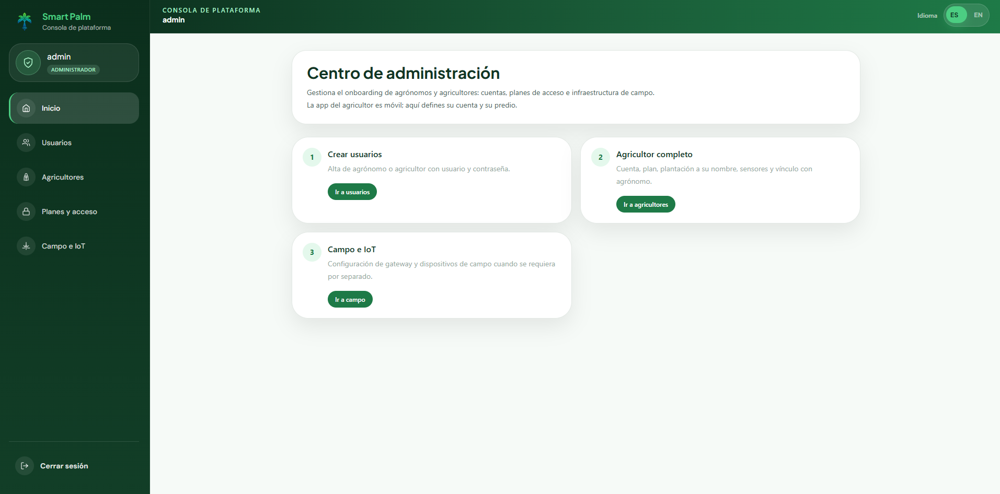

 

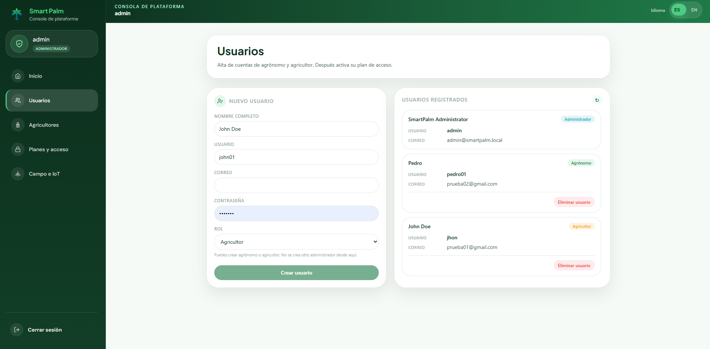

 

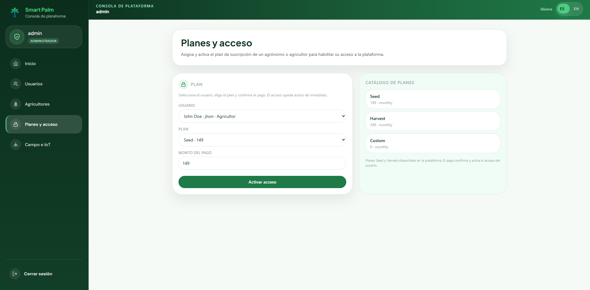

 

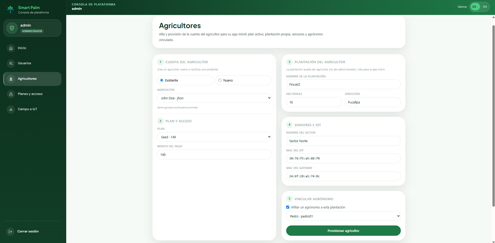

 

**Visualización interfaz agrónomo**

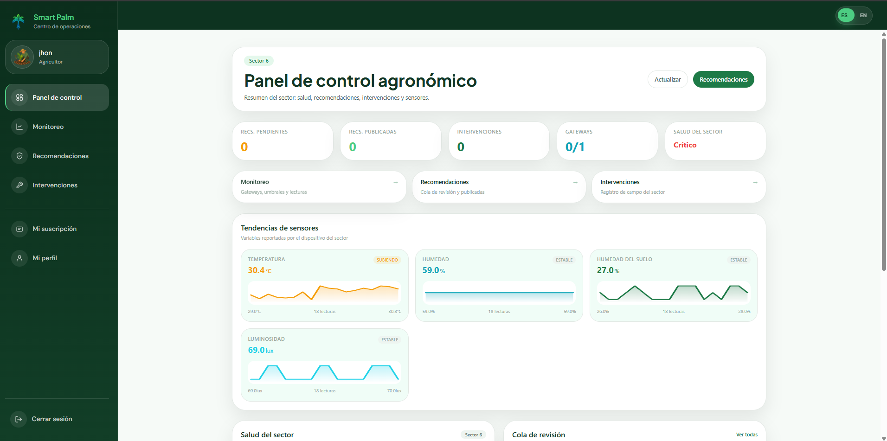

 

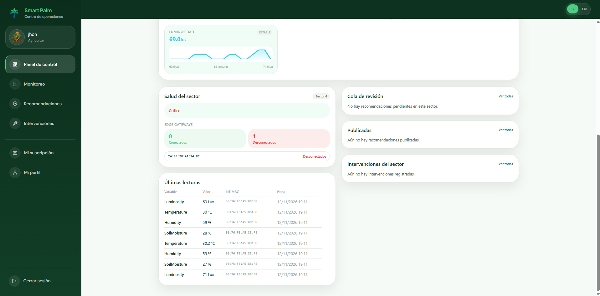

 

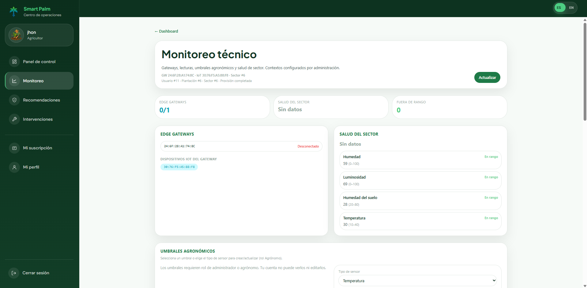

 

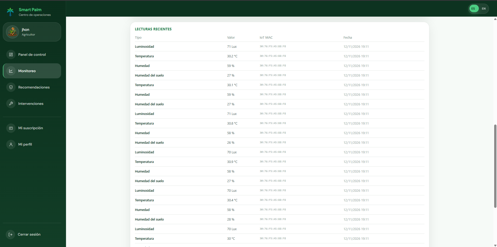

 

#### Web Services Execution Evidence

**Autenticación y Autorización**

- Inicio de sesión con una cuenta de usuario con rol admitido por la plataforma. La autenticación se realiza mediante el API Gateway y el microservicio de identidad, validando credenciales y generando un token JWT para la sesión activa.
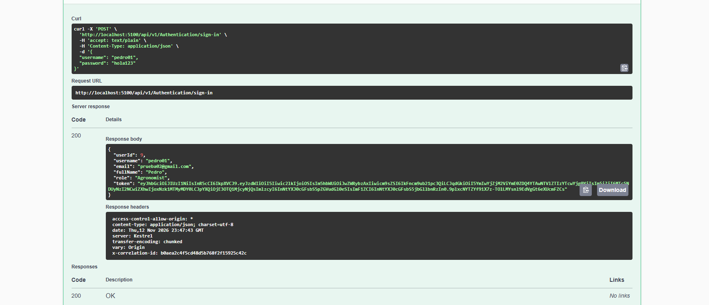

**Gestión de usuarios y roles**

- Gestión de usuarios registrados en la plataforma junto con información relevante.
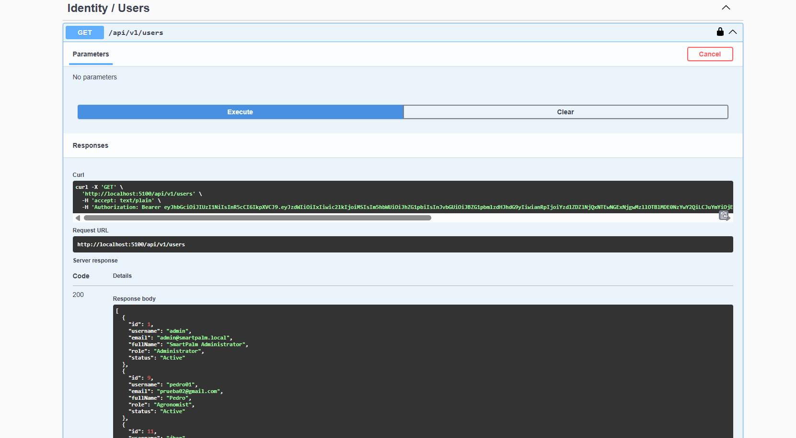

**Gestión de suscripciones y planes**

- Muestra las suscripciones activas de los usuarios y los planes disponibles para contratación.
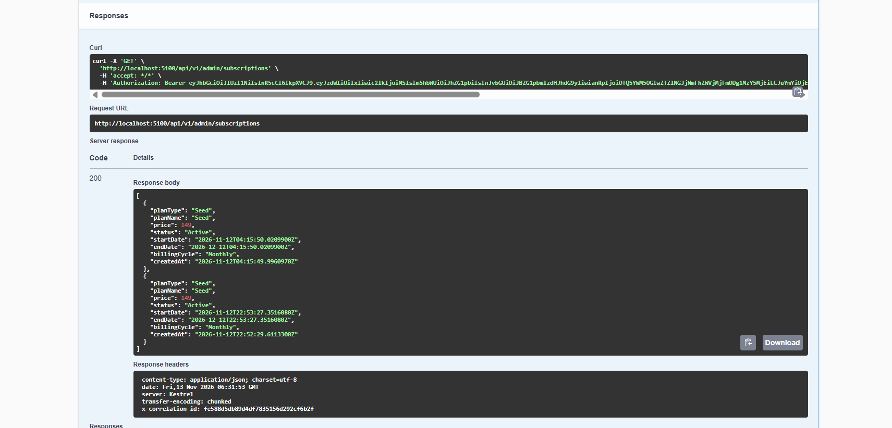

**Gestión de dispositivos registrados**

- Registro y visualización de los dispositivos IoT registrados en la plataforma, incluyendo pasarelas y sensores asociados a las plantaciones.
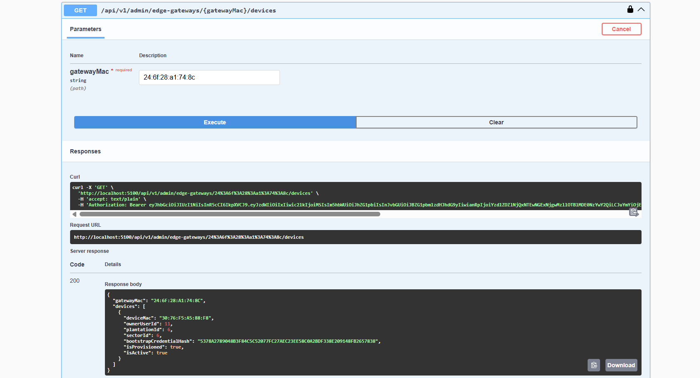  

**Registro de lecturas de sensores**

- Registro y visualización de las lecturas de sensores en tiempo real, mostrando datos de humedad, temperatura y otros parámetros críticos para el monitoreo del cultivo.
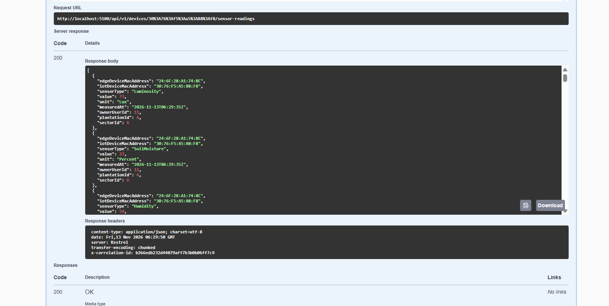

**Recomendaciones Agronómicas Asistidas por IA**

- Generación de recomendaciones personalizadas basadas en datos de sensores y análisis de inteligencia artificial con un modelo Open Source. La IA analiza las condiciones del cultivo y sugiere acciones para optimizar la producción y prevenir problemas.
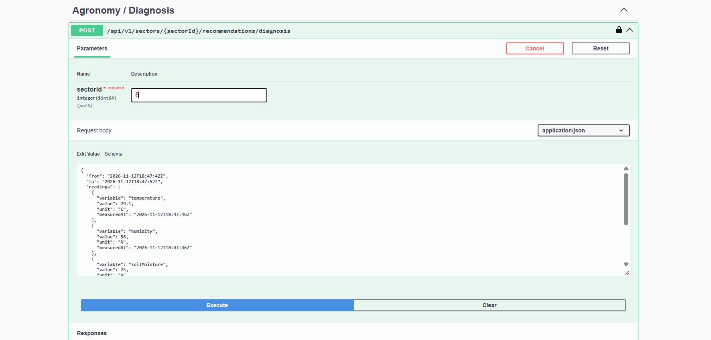
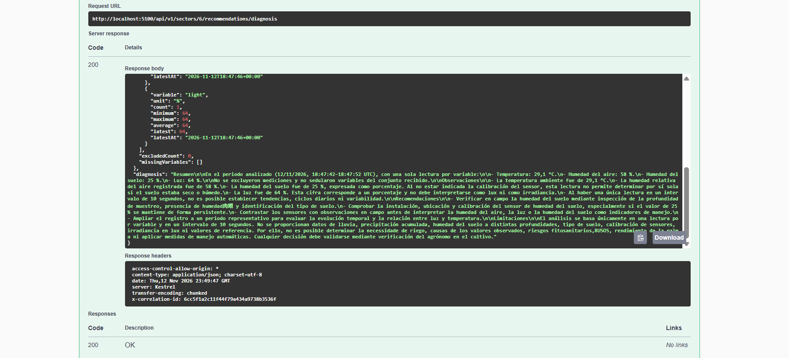

 

#### 7.2.1.6. Services Documentation Evidence for Sprint Review

En este sprint, la documentación de servicios corresponde a la integración mediante un API Gateway que centraliza y conecta todos los microservicios de la plataforma. El API Gateway gestiona y enruta las solicitudes necesarias para que la Web Application interactúe con los módulos de acceso, suscripciones, plantaciones, sectores, dispositivos IoT, lecturas de sensores, alertas, recomendaciones agronómicas, reportes e inspecciones de campo.

| Module | Resource | Main Actions | Sprint Relevance |
|---|---|---|---|
| Access | `/api/v1/Authentication/sign-in`, `/api/v1/admin/users`, `/api/v1/users/{id}`, `/api/v1/admin/users/deletion-operations/{operationid}` | Gestionar el inicio de sesión, registro, consulta de perfiles de usuario y operaciones administrativas de cuentas. | Permite navegar la Web Application con usuarios representativos y roles definidos. |
| Subscriptions | `/api/v1/admin/subscriptions`, `/api/v1/subscriptions`, `/api/v1/subscriptions/plans`, `/api/v1/subscriptions/payments`, `/api/v1/admin/subscriptions/{subscriptionid}`, `/api/v1/admin/subscriptions/users/{userid}` | Consultar planes, gestionar suscripciones y procesar pagos. | Soporta las historias de contratación y suscripción inicial de la plataforma. |
| Plantations | `/api/v1/plantations`, `/api/v1/plantations/{plantationId}`, `/api/v1/plantations/{plantationId}/sectors`, `/api/v1/admin/plantations`, `/api/v1/agronomists/{agronomistid}/plantation-affiliations`, `/api/v1/internal/reconciliation/snapshot` | Consultar plantaciones, detalles técnicos, sectores de monitoreo, afiliaciones de agrónomos y reconciliación de datos. | Soporta el dashboard, listado, asignación y detalle técnico de las plantaciones. |
| Device | `/api/v1/edge-gateways`, `/api/v1/edge-gateways/{gatewayMac}/devices`, `/api/v1/admin/edge-gateways`, `/api/v1/admin/edge-gateways/{gatewayMac}/iot-devices`, `/api/v1/admin/iot-devices/{iotMac}/provision`, `/api/v1/admin/iot-devices/{iotMac}/revoke`, `/api/v1/edge-gateways/{gatewayMac}/registry`, `/api/v1/edge-gateways/{gatewayMac}/connectivity` | Gestionar edge gateways, registrar dispositivos IoT, control de conectividad y aprovisionamiento de dispositivos. | Permite evidenciar el componente IoT y la sincronización de pasarelas dentro de la arquitectura. |
| Sensor Readings | `/api/v1/devices/{deviceMac}/sensor-readings`, `/api/v1/edge-gateways/{gatewayMac}/sensor-readings`, `/api/v1/sectors/{sectorid}/sensor-readings`, `/api/v1/sectors/{sectorid}/health`, `/api/v1/admin/devices/{deviceMac}/thresholds`, `/api/v1/devices/{deviceMac}/thresholds` | Consultar lecturas de sensores, estado de salud del sector y configurar umbrales agronómicos. | Alimenta la visualización en tiempo real del estado y salud del cultivo. |
| Alerts | `/api/v1/admin/alerts`, `/api/v1/alerts`, `/api/v1/alerts/{alertId}`, `/api/v1/alerts/{alertId}/acknowledge`, `/api/v1/alert-settings`, `/api/v1/alert-settings/{sensortype}` | Consultar alertas administrativas, de usuario, reconocimiento de eventos críticos y configuración de umbrales. | Permite priorizar condiciones críticas y gestionar notificaciones dentro de la Web Application. |
| Agronomy Recommendations | `/api/v1/sectors/{sectorid}/recommendations`, `/api/v1/recommendations/general`, `/api/v1/reports/{reportid}/recommendations`, `/api/v1/recommendations/{recommendationid}`, `/api/v1/recommendations/{recommendationid}/approval`, `/api/v1/recommendations/{recommendationid}/publication` | Consultar, generar, aprobar y publicar recomendaciones agronómicas por sector o reporte. | Soporta la experiencia especializada del agrónomo y la toma de decisiones del productor. |
| Reports | `/api/v1/sectors/{sectorid}/reports`, `/api/v1/reports/{reportid}`, `/api/v1/reports/{reportid}/publication` | Consultar, generar y publicar reportes técnicos del estado de los sectores. | Permite mostrar documentación consolidada del estado del cultivo. |
| Field Records | `/api/v1/field/visits/{visitid}/inspections`, `/api/v1/field/visits/{visitid}/inspections/sync`, `/api/v1/field/inspections/{id}`, `/api/v1/field/plantations/{plantationid}/inspections`, `/api/v1/field/visits`, `/api/v1/field/visits/{id}/start`, `/api/v1/field/visits/{id}/complete`, `/api/v1/field/visits/{id}/cancel`, `/api/v1/field/interventions`, `/api/v1/sectors/{sectorid}/interventions`, `/api/v1/field/interventions/{id}/verify`, `/api/v1/field/interventions/{id}/reject` | Gestionar visitas de campo, inspecciones (online/offline y sincronización), observaciones, alertas y ciclo de vida de intervenciones agronómicas. | Complementa la trazabilidad estricta del seguimiento operativo y agronómico en campo. |

#### Identity Service
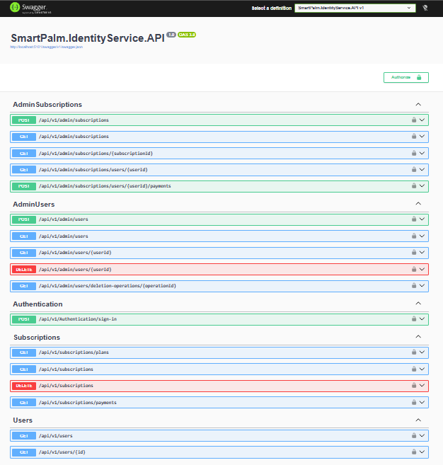

#### Agronomy Service

#### Ingestion Service 

#### Device Service
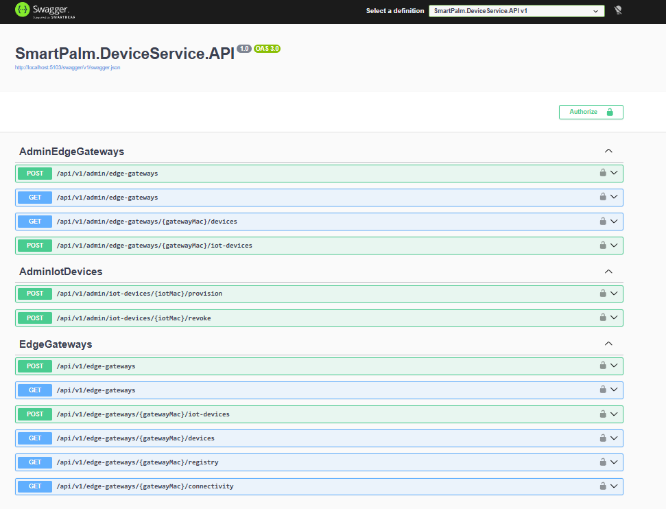

#### Field Service
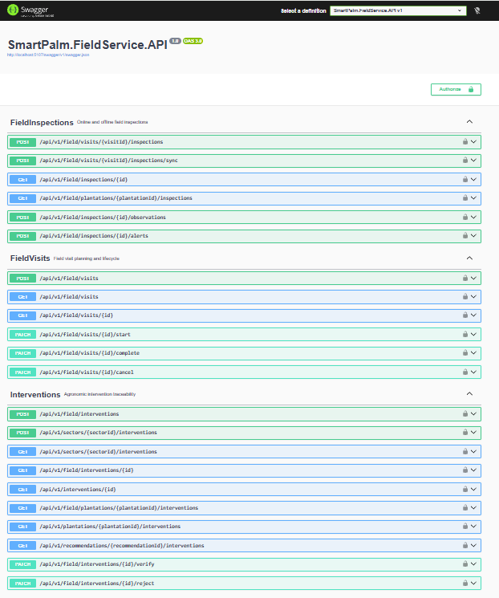

#### Alert Service
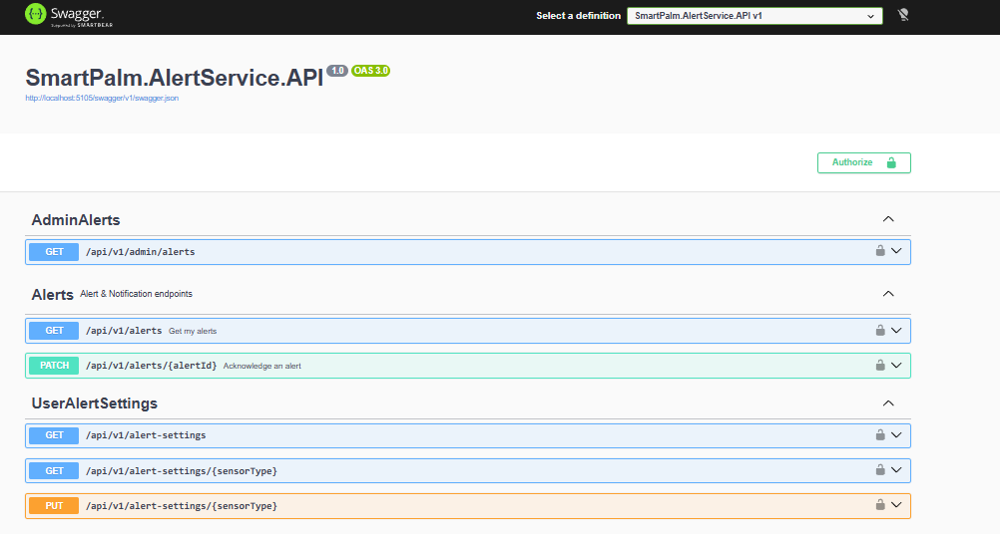

#### Crop Serrvice 
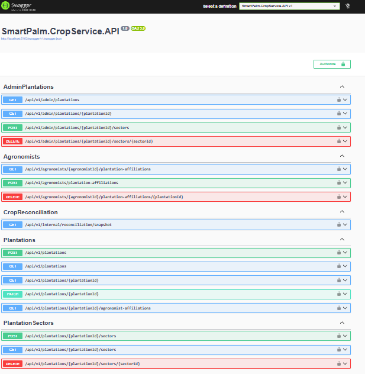

#### API Gateway

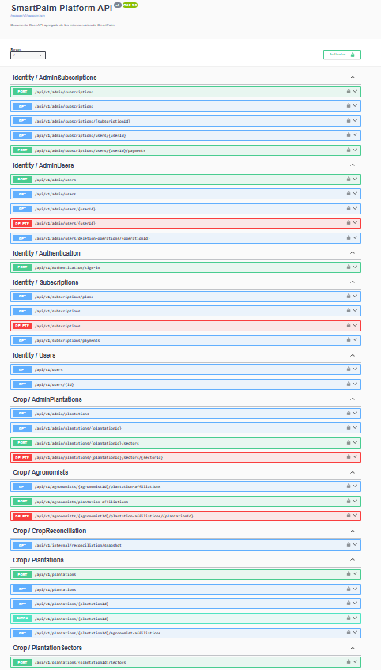

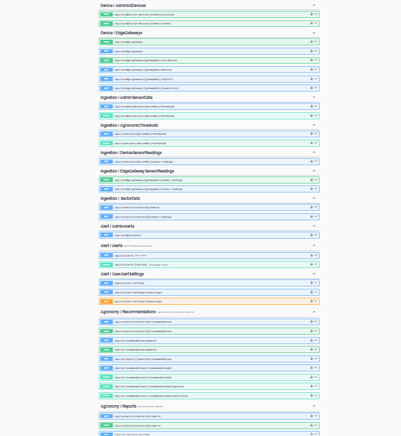

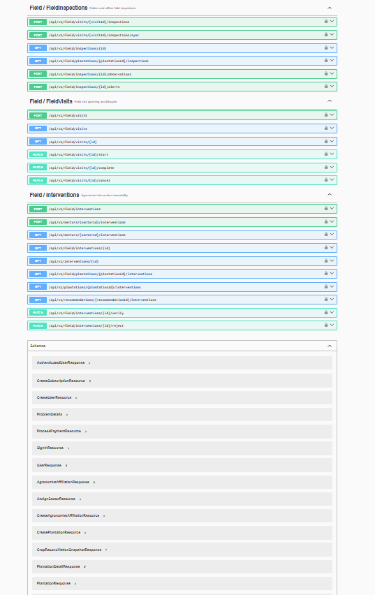

#### 7.2.1.7. Software Deployment Evidence for Sprint Review

En el Sprint 1 se desplegaron los artefactos del alcance, incluyendo el Landing Page, la Web Application y la arquitectura centralizada de microservicios mediante el API Gateway.

| Artifact | Deployment Status | URL / Environment |
|---|---|---|
| Landing Page | Deployed | https://smartpalm-landing.vercel.app/ |
| Web Application | Deployed | https://smartpalm-webapp.onrender.com/auth/login |
| API Gateway & Microservices | Deployed | https://smartpalm-api-gateway.onrender.com/ |

#### 7.2.1.8. Team Collaboration Insights during Sprint

Durante el Sprint 1, el equipo distribuyó el trabajo en múltiples frentes clave: Landing Page, Web Application, API Gateway y microservicios backend. El Landing Page permitió mostrar la propuesta de valor y el modelo comercial de SmartPalm. Por su parte, la Web Application permitió navegar las primeras vistas funcionales del sistema conectándose al API Gateway para gestionar la autenticación, plantaciones, dispositivos IoT y alertas en tiempo real.

| Team Member | Sprint 1 Contribution |
|---|---|
| Victor Manuel Rojas Reategui | Coordinación documental, integración del reporte y apoyo en producto. |
| Camila Conde Isla | Liderazgo del Landing Page y apoyo en diseño de la experiencia pública. |
| Mauricio Muñoz | Colaboración en estructura funcional y documentación técnica del producto. |
| Kenyi Ramirez | Colaboración en arquitectura y soporte de organización técnica. |
| Jeremy Alión Paucar Meneses | Liderazgo de Web Application, Mock API y despliegue de la experiencia funcional. |

